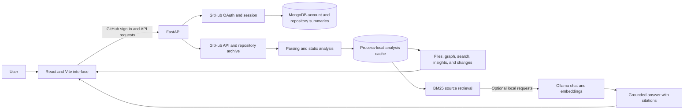

<div align="center">

# 🧭 REPOMIND

### *Understand what you're looking at.*


<br/>


<br/><br/>

**RepoMind turns a public GitHub repository into an interactive guide to its files, connections, code signals, and changes.**

Browse a project visually, ask plain-English questions about its source, and follow answers back to the files they came from.

<br/>

[Overview](#-project-overview) •
[Features](#-core-capabilities) •
[Architecture](#-system-architecture) •
[Technology](#-technology-stack) •
[Setup](#-installation--setup) •
[API](#-api-reference) •
[Safety](#-safety--limitations) •
[Roadmap](#-future-roadmap)

</div>

<br/>

> ⚠️ **PLEASE READ**
> RepoMind is a development and learning tool. It analyzes **public GitHub repositories** and does not execute repository code. Review signals are estimates to help guide exploration; they are not confirmed bugs or calibrated probabilities.

---

## 🌌 Project Overview

New codebases can be difficult to understand, especially when you are unfamiliar with the project or with GitHub. RepoMind creates a navigable snapshot of a public repository so people can see how its files relate, search its source, and explore important areas.

The interface is designed for both experienced developers and people who are new to repositories. Beginner-friendly explanations are available alongside file, architecture, search, review, and change views.

<div align="center">

| 🗺️ **See the structure** | 🔎 **Find useful context** | 💬 **Ask in plain English** | 🛡️ **Understand the signals** |
| :---: | :---: | :---: | :---: |
| Explore files and their resolved imports | Search source, symbols, and filenames | Get answers grounded in repository evidence | See how static measurements are calculated |

</div>

---

## 🎯 Project Goals

* Make unfamiliar repositories easier to explore.
* Explain technical concepts in language that beginners can follow.
* Show file relationships inferred from analyzed source.
* Ground answers in source files and provide citations.
* Present code measurements as evidence for exploration, not as proof of defects.
* Keep repository code unexecuted during analysis.

---

## ✨ Core Capabilities

<details open>
<summary><b>📥 Repository analysis</b></summary>
<br/>

* Accepts public GitHub repository URLs.
* Pins analysis to a specific commit.
* Downloads and analyzes eligible repository files.
* Reports progress while an analysis job runs.
* Applies file-count, archive-size, and file-size limits.

</details>

<details open>
<summary><b>📁 Files and source</b></summary>
<br/>

* Browse the analyzed file tree.
* Inspect source with line numbers and basic syntax highlighting.
* Review extracted functions, classes, symbols, and imports.
* Search filenames, source text, and symbols.

</details>

<details open>
<summary><b>🕸️ Connections and architecture</b></summary>
<br/>

* Explore file-level relationships resolved from imports.
* Open a connected file from the map.
* See which references are present in analyzed files.
* Treat the graph as a static view; dynamic relationships may not be detected.

</details>

<details open>
<summary><b>📊 Highlights and review signals</b></summary>
<br/>

* Compare file sizes, complexity estimates, and incoming links.
* Inspect recent commit history and file-change signals.
* See a relative review ranking when enough history is available.
* Read the reasons and limitations behind each signal.

</details>

<details open>
<summary><b>🔍 Change impact and suggestions</b></summary>
<br/>

* Trace resolved dependencies that may be affected by a file change.
* See token-based similar-code matches.
* Receive filename-based test suggestions.
* Review advisory findings for changed lines in a pull request.

</details>

<details open>
<summary><b>💬 Ask your questions</b></summary>
<br/>

* Ask questions in natural English about the analyzed repository.
* Choose starter questions if you are new to code or GitHub.
* Receive citations that link to relevant files and line ranges.
* When local AI is unavailable, RepoMind can still show retrieved evidence; generated explanations require Ollama.

</details>

<details open>
<summary><b>🔐 Sign-in and dashboard</b></summary>
<br/>

* Sign in with GitHub before analyzing a repository.
* View your account profile and saved repository summaries.
* Reopen an analysis while its results remain available in the running backend process.
* MongoDB stores account information and repository summaries; full analysis results are currently held in process memory.

</details>

---

## 🏛️ System Architecture



---

## 🔄 Analysis Workflow

```mermaid
flowchart LR
    A([Sign in with GitHub]) --> B[Enter a public repository URL]
    B --> C[Validate repository and fetch commit]
    C --> D[Download eligible files]
    D --> E[Parse source and resolve imports]
    E --> F[Build file and code signals]
    F --> G[Explore files, connections, and highlights]
    G --> H[Ask questions or inspect changes]
    H --> I([Open cited source context])

    classDef action fill:#b51b83,stroke:#29241d,color:#fff,stroke-width:2px
    classDef process fill:#c8eee2,stroke:#29241d,color:#211d18,stroke-width:2px
    classDef result fill:#ffe88f,stroke:#29241d,color:#211d18,stroke-width:2px
    class A,I result
    class B,C,D,E,F process
    class G,H action
```



---

## 🧰 Technology Stack

<div align="center">

| Layer | Technology | Purpose |
| :--- | :--- | :--- |
| 🎨 Frontend | React, Vite, JavaScript, CSS | Interactive repository exploration interface |
| ⚙️ API | Python, FastAPI | Versioned API, analysis jobs, and session handling |
| 🔐 Authentication | GitHub OAuth, Starlette sessions | Sign-in and account sessions |
| 🗄️ Account data | MongoDB | User profiles and saved repository summaries |
| 🧩 Parsing | Python AST, Tree-sitter where available | Extract source structure and imports |
| 📈 Review signals | scikit-learn and static measurements | History-based relative ranking and file signals |
| 💬 Local AI | Ollama, optional | Source-grounded chat and optional embedding reranking |
| 🔎 Retrieval | BM25 lexical retrieval | Find source excerpts relevant to a question |

</div>

---

## 📁 Repository Structure

```text
RepoMind/
├── README.md
├── backend/
│   ├── .env.example
│   ├── requirements.txt
│   └── app/
│       ├── main.py
│       ├── api/routes/       → auth, repositories, intelligence
│       ├── core/             → configuration and security
│       ├── engines/          → parsing and ML risk analysis
│       └── services/         → GitHub, history, and intelligence
├── frontend/
│   ├── package.json
│   └── src/
│       ├── App.jsx
│       ├── components/       → account dashboard and architecture graph
│       ├── pages/            → repository views
│       ├── services/         → API client
│       └── styles/           → shared interface styles
├── docs/                     → architecture, API, safety, deployment, evaluation
└── ml/                       → model-related project materials
```

---

## ⚙️ Installation & Setup

### Requirements

* Python 3.11+
* Node.js 20+
* Git
* MongoDB connection string
* GitHub OAuth application
* Ollama is optional; it is needed for generated AI explanations and embedding reranking.

### 1. Clone the repository

```powershell
git clone https://github.com/Shivanshi388/RepoMind.git
Set-Location RepoMind
```

### 2. Configure the backend

```powershell
Set-Location backend
py -3.11 -m venv .venv
.\.venv\Scripts\Activate.ps1
python -m pip install -r requirements.txt
Copy-Item .env.example .env
```

Open `backend/.env` and add your own values for these required settings:

```dotenv
GITHUB_CLIENT_ID=
GITHUB_CLIENT_SECRET=
AUTH_SECRET_KEY=
MONGODB_URI=
MONGODB_DATABASE=repomind_db
FRONTEND_URL=http://localhost:5173
```

Set the GitHub OAuth callback URL to:

```text
http://localhost:8000/api/v1/auth/github/callback
```

`AUTH_SECRET_KEY` must be a long, private random value. Keep `.env` on your computer; never commit it.

### 3. Start the backend

From the `backend` directory, with the virtual environment active:

```powershell
uvicorn app.main:app --reload --port 8000
```

The API health check is at `http://localhost:8000/health`. Interactive API documentation is at `http://localhost:8000/docs`.

### 4. Start the frontend

Open a second terminal:

```powershell
Set-Location "$env:USERPROFILE\Desktop\RepoMind\frontend"
npm install
npm run dev
```

Open the Vite address shown in the terminal, usually `http://localhost:5173`.

### Optional: enable local AI

Install Ollama, then pull the models configured by default:

```powershell
ollama pull qwen2.5-coder:3b
ollama pull embeddinggemma
```

RepoMind connects only to loopback Ollama addresses. Chat generation and embedding reranking are optional; without a local model, lexical retrieval and source citations remain available.

---

## 🔌 API Reference

The API is prefixed with `/api/v1`, except for `/health`.

<div align="center">

| Method | Endpoint | Description |
| :---: | :--- | :--- |
| `GET` | `/health` | Check API availability |
| `GET` | `/api/v1/auth/github/login` | Start GitHub sign-in |
| `GET` | `/api/v1/auth/me` | Get the current signed-in profile |
| `POST` | `/api/v1/auth/logout` | End the current session |
| `GET` | `/api/v1/auth/repositories` | List saved repository summaries |
| `POST` | `/api/v1/repositories/analyze` | Start analysis; requires sign-in |
| `GET` | `/api/v1/repositories/jobs/{job_id}` | Check analysis progress |
| `GET` | `/api/v1/repositories/{repo_id}` | Get repository overview |
| `GET` | `/api/v1/repositories/{repo_id}/files` | List analyzed files |
| `GET` | `/api/v1/repositories/{repo_id}/files/content?path=...` | Read a file in the analysis |
| `GET` | `/api/v1/repositories/{repo_id}/architecture` | Get file relationship graph |
| `GET` | `/api/v1/repositories/{repo_id}/search?q=...` | Search repository source |
| `GET` | `/api/v1/repositories/{repo_id}/insights` | Get file and language insights |
| `GET` | `/api/v1/repositories/{repo_id}/risk` | Get relative review rankings |
| `GET` | `/api/v1/repositories/{repo_id}/history` | Inspect recent commit history |
| `GET` | `/api/v1/repositories/{repo_id}/impact?path=...` | Estimate affected files |
| `GET` | `/api/v1/repositories/{repo_id}/similarity?path=...` | Find token-similar code |
| `GET` | `/api/v1/repositories/{repo_id}/test-suggestions` | Suggest related tests |
| `GET` | `/api/v1/repositories/{repo_id}/semantic-search?q=...` | Search with optional local reranking |
| `POST` | `/api/v1/repositories/{repo_id}/chat` | Ask a source-grounded question |
| `POST` | `/api/v1/repositories/{repo_id}/debug` | Get evidence-based debugging leads |
| `POST` | `/api/v1/repositories/{repo_id}/code-review` | Run advisory static review |
| `POST` | `/api/v1/repositories/{repo_id}/compare` | Compare two revisions |
| `POST` | `/api/v1/repositories/{repo_id}/pull-request` | Inspect a public pull request diff |

</div>

---

## 🛡️ Safety, Privacy & Interpretation

* Only public GitHub repositories are accepted.
* Repository code is analyzed as data and is never executed.
* Dependencies from analyzed repositories are never installed.
* Archive redirects are restricted to GitHub archive hosts.
* File, tree, and archive size limits are enforced.
* GitHub OAuth is required before starting an analysis.
* MongoDB stores account information and saved repository summaries, not full source snapshots.
* Full analysis results are held in the backend process cache and are lost when that process restarts.
* Ollama requests are sent only to a local loopback address; RepoMind does not use a hosted LLM.

### Understanding review signals

History-based rankings use a limited number of recent commits and commit-message wording as noisy training labels. They are **relative review signals**, not calibrated probabilities that a file contains a bug. Training is skipped when the available history is insufficient.

Impact analysis follows dependencies that RepoMind could resolve statically. Dynamic imports, runtime behavior, and external services may not appear. Similarity uses token overlap. Test suggestions are informational; RepoMind does not run repository tests. Pull request findings are advisory.

---

## 🧪 Checks

From the backend directory:

```powershell
python -m pytest
```

From the frontend directory:

```powershell
npm run build
```

---

## 🛣️ Future Roadmap

| Area | Potential improvement |
| :--- | :--- |
| 💾 Persistence | Store complete analysis snapshots so they survive backend restarts |
| 🕸️ Architecture | Add map filtering, zoom, pan, and larger-graph navigation |
| 🔎 Search | Improve semantic retrieval availability and model setup guidance |
| 📊 Review signals | Improve training data quality and evaluation coverage |
| ☁️ Deployment | Add production deployment guidance and multi-user resource controls |
| 🌱 Onboarding | Expand beginner explanations across repository exploration flows |

---

## 📚 Documentation

See [`docs/`](docs/) for architecture, API documentation, database schema, AI safety, deployment guidance, and ML evaluation details.

---

## 📜 License

No `LICENSE` file is currently included. Add a license before redistributing or accepting external contributions under specific terms.

---

<div align="center">

**Built to make codebases easier to understand.**

[Back to top](#-repomind)

</div>